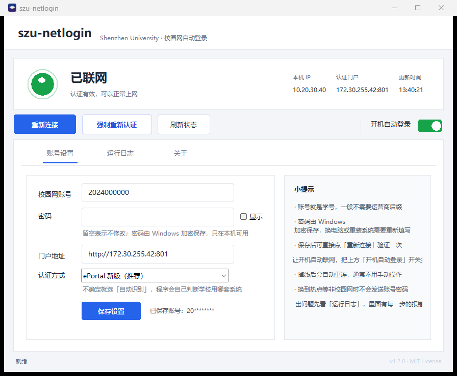

# szu-netlogin

> 深圳大学校园网自动登录：开机自动认证，不用再开浏览器输账号密码。

适配 Dr.COM 城市热点新版 eportal（`http://172.30.255.42:801`），Windows 10 / 11。



> 截图中的账号与 IP 均为虚构示例。

---

## 方法一：下载安装包（推荐）

适合只想用的同学，不需要安装 Python。

到 [Releases](../../releases) 下载 **`szu-netlogin-v1.2.0-win64.zip`**（约 11 MB）。

**解压前先解除锁定**（重要，否则每次运行都会弹「无法验证发布者」）：

1. 右键下载好的 zip →「属性」；
2. 勾选底部的「**解除锁定 / Unblock**」→ 确定；
3. 再把整个文件夹解压出来。

然后双击里面的 `启动.vbs`（或 `szu-netlogin.exe`）：

1. 点「账号设置」，填学号和密码，点「保存设置」
2. 打开右上角「开机自动登录」开关
3. 完成

- **不需要安装 Python**，解压即用
- 解压后的 `_internal` 文件夹必须和 exe 放在一起，别只把 exe 单独拖出来
- 首次运行 Windows 或杀毒软件可能提示"未知发布者"，点「更多信息 → 仍要运行」
- 如果没解除锁定导致每次双击都弹提示，改用同目录的 **`启动.vbs`**（见常见问题）
- 账号密码只留在本机

## 方法二：从源码运行

适合想改代码、或自己打包的同学，需要 Python 3.8 及以上。

1. **装 Python**：从 [python.org](https://www.python.org/downloads/) 下载，安装时勾选 `Add Python to PATH`。
2. **打开界面**：双击 `图形界面.bat`。
3. **填账号**：切到「账号设置」，输入学号、密码，点「保存设置」。
4. **开自启**：把右上角「开机自动登录」开关打开。

以后开机不用管了。守护默认每 30 分钟检查一次（断网时前 4 分钟会每秒级快速重试），
想改频率用 `python autologin.py --watch --interval 600`（秒）；`--interval 0` 表示只在启动时检查一次、不常驻。

---

## 界面说明

| 区域 | 作用 |
| --- | --- |
| 顶部状态卡 | 绿点「已联网」/ 红点「未联网」，本机 IP、认证门户、更新时间 |
| 立即连接 | 未联网时点它；已联网时文案变成「重新连接」 |
| 强制重新认证 | 网页打不开、认证卡住时用 |
| 刷新状态 | 重新检测一次 |
| 开机自动登录 | 开关式装 / 卸开机自启 |
| 账号设置 | 改学号、密码、门户地址、认证方式 |
| 运行日志 | 最近 300 行日志，可打开完整文件 |
| 关于 | 版本、来源、配置路径、「清除账号数据」 |

界面细节：窗口淡入、状态圆点呼吸/涟漪、圆角输入框聚焦渐变与发光、按钮悬停、标签页下划线滑动、连接中动态省略号。

---

## 常见问题

| 现象 | 处理 |
| --- | --- |
| 提示「账号或密码被拒绝」 | 密码错了。重新在「账号设置」里填一次；不要连续重试 |
| 换电脑 / 重装系统后不能登录 | 密码绑定本机，重新填一次即可 |
| 开机没有自动登录 | 检查开关是否打开；移动过文件夹就关掉再打开一次 |
| 日志显示「当前不在校园网」 | 正常保护：只有连上校园网才会发送账号密码 |
| 想彻底卸载 | 双击程序文件夹里的 **`卸载.bat`**：自动关闭程序、删除开机自启、配置、加密密码和整个程序文件夹。也可以在「关于」页点「清除账号数据」，再双击 `卸载.bat` |
| 双击提示「无法验证发布者」 | 这是 Windows 对未签名 exe 的发布者校验。**解压前先右键 zip → 属性 → 勾选「解除锁定」**，再解压即可消除；或者用同目录的 `启动.vbs` 启动 |
| 为什么发布包是文件夹，而不是单个 exe？ | 单文件 exe 每次启动都要把自身解压到系统临时目录，部分机器的安全策略会拦住这一步（报 `Could not create temporary directory!`）。文件夹版运行时不需要解压，启动更快，也不会被这个策略影响 |

账号密码只保存在本机：配置在 `%APPDATA%\campusnet`，密码用 Windows DPAPI 加密，**换电脑解不开**，源码和仓库里没有任何凭据。

---

## 文件位置

| 内容 | 路径 |
| --- | --- |
| 程序目录 | 当前文件夹 |
| 启动入口 | `szu-netlogin.exe`（发布包）/ `图形界面.bat`（源码） |
| 无提示启动器 | `启动.vbs`（绕开「无法验证发布者」提示） |
| 配置 | `%APPDATA%\campusnet\config.json` |
| 加密密码文件 | `%APPDATA%\CampusNetAutoLogin\password.dat` |
| 日志 | `%APPDATA%\CampusNetAutoLogin\autologin.log` |
| 卸载脚本 | 程序文件夹里的 `卸载.bat` |

`password.dat` 就是**保存你校园网密码的文件**：第一次在界面里点「保存设置」时，程序用 Windows 的 DPAPI 把密码加密后写进这里；每次登录时再解密取出来用，所以不用反复输入。它和当前 Windows 账户绑定，拷到别的电脑上解不开；删掉它不会损坏程序，只是下次需要重新填一次密码。

---

## 命令行（可选）

```console
python autologin.py              # 登录一次
python autologin.py --status     # 看状态
python autologin.py --diagnose   # 排障
python autologin.py --watch      # 常驻守护（开机自启跑的就是它）
```

命令行和图形界面共用同一份配置，互不冲突。

## 给别的学校用

打开「账号设置」，把认证方式先选「自动识别」；或运行 `python -m campusnet setup` 让它探测门户。代码里的默认值只是本校兜底，不用改源码。

## 说明

- 认证引擎来自开源项目 [campusnet](https://github.com/demo133/campusnet)（MIT License），本仓库在其上增加了本校适配、DPAPI 密码加密、开机自启与图形界面。
- 本项目以 **MIT License** 发布，详见 [LICENSE](LICENSE)；分发时请一并保留上游版权声明。
- 认证协议细节见 [docs/PROTOCOL.md](docs/PROTOCOL.md)。
- 发布流程、上传哪些文件见 [docs/RELEASE.md](docs/RELEASE.md)。
- 图标为原创设计（深蓝紫徽章 + Wi-Fi + 金色节点 + SZU 字样），未使用学校官方校徽素材。
- 仅供本人账号在自己电脑上自动登录使用，请遵守学校网络管理规定。
